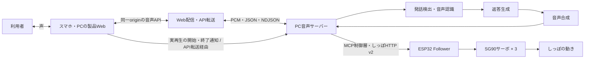

# ねんぎつね（仮） — 一日の終わりに、声としっぽで寄り添う。

**寝る前の「ちょっと聞いて」に、声と動きで応えるきつね型の添い寝ロボット。**

JPHACKS 2026 / `kz_2614`　｜　音声AI × ロボティクス × おやすみ時間

<p align="center">
  
</p>
<p align="center"><em>ねんぎつねの外装試作。2026年10月25日の制作写真。</em></p>

<p align="center">
  <a href="https://hiroron-jphacks2026.hiroron.net/">製品Web</a> ·
  <a href="docs/gallery.md">写真・画面ギャラリー</a> ·
  <a href="docs/demo.md">デモ手順</a> ·
  <a href="docs/README.md">技術仕様書</a>
</p>

> 開発中のプロトタイプです。公開Webは認証が必要で、公開環境での音声・実機を通した動作確認は継続中です。写真は外装・機構の制作状況を示しています。

## 目次

- [製品概要](#製品概要)
- [体験の流れ](#体験の流れ)
- [特長](#特長)
- [システム構成](#システム構成)
- [注力したこと](#注力したこと)
- [デモと開発状況](#デモと開発状況)
- [開発技術](#開発技術)
- [今後の展望](#今後の展望)
- [開発・技術資料](#開発技術資料)
- [チーム](#チーム)

## 製品概要

### 背景・解決したい課題

一日が終わり、ベッドに入ったとき。「今日あったことを少しだけ話したい」「ひとりで過ごす夜にも、そばにいる気配がほしい」。ねんぎつねは、そんな時間に寄り添うことを目指しています。

話を聞いてくれる声に、ぬいぐるみの姿としっぽの動きを重ねる。画面で完結する会話に身体のある相手の存在感を加え、眠る前にひと息つくきっかけをつくります。

### 製品説明

**ねんぎつねは、スマートフォンの音声会話と、きつね型の人形を組み合わせた添い寝ロボットです。**

ブラウザーから話しかけると、PCが音声を認識し、AIの返答を音声で返します。機器連携を有効にした構成では、AIの声が端末で再生され始めるタイミングに合わせて、しっぽが短く動きます。

現在のMVPは「**スマホで会話・しっぽの動作・停止・利用記録**」の4つです。詳しい対象範囲と受け入れ条件は [MVP.md](MVP.md) にまとめています。

### 届けたいこと

- 寝る前に、一日の出来事を声に出して話せる時間。
- 声だけでなく、人形の姿や動きからも感じられる相手の気配。
- 自分で会話時間を決め、終わった時間を振り返れるおやすみの習慣。

## 体験の流れ

接続と機器の準備を済ませた環境で、次の流れを目指しています。実際の試験条件は [デモ手順](docs/demo.md) を参照してください。

1. **今夜のおやすみ時間を選ぶ。** 製品Webで会話時間を選びます。寝る時間・起きる時間は目安として設定できます。
2. **ねんぎつねに話しかける。** 会話を開始し、マイクを許可します。AIの返答中にも話しかけ直せます。
3. **声としっぽの反応を感じる。** 許可された機器が、AIの実際の再生開始に合わせて短く動きます。
4. **会話を終え、記録を見る。** 終了操作や設定時間の経過で端末の録音・再生を止め、開始・終了時刻や終了理由をダイアリーへ残します。

<p align="center">
  
</p>
<p align="center"><em>おやすみの準備画面。表示される予定時刻は目安で、アラーム機能ではありません。</em></p>

## 特長

### 声と動きがつながる

返答を生成した時点ではなく、**端末がAIの音声を実際に再生し始めた時点**を動作のきっかけにします。最新mainでは1返答につき1回・2秒の動作を要求し、返答終了や割込み時には停止処理を行います。動作許可や時間の上限を満たさない場合は動かしません。

### 話しかけ直せる会話

音声入力を継続してPCへ送り、発話の区切りを検出します。AIが返答している途中でも新しい発話を受け付け、前の返答を打ち切って会話を切り替えます。

### おやすみ時間に合わせたWeb画面

夜をイメージした配色ときつねのイラストで、会話時間の設定・開始・終了・記録をひとつのWebアプリにまとめています。会話時間は15〜90分から選び、開始時に確定します。

### 終わるところまで設計する

手動終了だけでなく、時間切れ・画面非表示・障害時にも端末の録音と再生を止めます。端末の停止、サーバーの停止、機器からの停止応答を分けて確認し、確認できない状態を成功として表示しません。

## システム構成



ブラウザーはESP32を直接操作せず、PCが会話状態・機器の許可・動作予算を確認して指令を送ります。音声APIの `/api/v1/voice/` と、しっぽAPIの `/api/v2/tail/` は、それぞれ独立した版の契約です。

詳細は [構成と処理フロー](docs/architecture.md)、[音声HTTP API](docs/api/voice-http.md)、[しっぽv2契約](docs/api/mvp-tail-control-v2.md) を参照してください。

## 注力したこと

### ぬいぐるみの中に、動く仕組みをつくる

しっぽの機構は、3台のSG90サーボと3Dプリント部品を組み合わせて試作しています。外装と内部機構をそれぞれ製作し、人形としての形と可動部の収まりを検討しています。

<p align="center">
  
</p>
<p align="center"><em>しっぽ機構の制作写真。外装への組込み前の構造が分かる状態。</em></p>

### 会話を途切れさせにくい音声処理

継続的なPCM送受信、返答中の発話受付、短い通信遅延からの復旧を実装しました。古い会話や返答の音声を再生しないよう、セッションと返答の世代を管理しています。

### 動作に上限を設け、停止を独立して扱う

機器側の速度・動作時間・直近60秒の予算を制約し、遅れて届いた古い指令で再び動き出すことを防ぎます。現在の再生連動は2秒ずつ、60秒内の予約時間合計は最大10秒です。機器が返す「指令停止」と、人が観察する「物理的に止まったこと」は区別して検証します。

### 記録と通信の失敗も扱う

利用記録をID単位で保存し、複数タブ・再読込・保存失敗を扱います。Service WorkerはAPI・音声・認証応答をキャッシュしません。音声モデルそのものではなく、既存モデルをつなぐ会話処理とWeb・機器の連携をチームで開発しています。

## デモと開発状況

**[製品Webを開く](https://hiroron-jphacks2026.hiroron.net/)** / **[写真・画面ギャラリー](docs/gallery.md)** / **[通し試験の手順](docs/demo.md)**

公開Webにはhiroron Passportの認証が必要です。公開経路での音声接続・実スマホ・実機を通した受け入れは未完了です。デモ動画は準備中です。

2026年10月25日、main `47d4e83` までの実装・検証記録に基づく状況です。以下は記録済みの結果であり、このREADME更新で試験を再実行したものではありません。

| 対象 | 確認できていること | 残っている確認 |
| --- | --- | --- |
| PC音声会話 | 実モデルによるSTT → LLM → TTSのHTTP試験記録あり | 製品Web・実スマホを含む全体の通し試験 |
| 製品Web | UI・共有音声クライアント・利用記録を実装。別PCのstatus APIへの疎通記録あり | 公開認証後の音声接続、実端末での操作・停止・記録 |
| 会話開始・終了と機器の許可 | 実Followerへの開始時prepare・終了時disarmを確認 | 実マイクからの一連の操作の再確認 |
| AI再生に連動するしっぽ | 利用者による物理動作の確認記録あり。2秒版は模擬再生通知＋実Followerで連続2回の受付・idle・停止を確認 | 最新版の実ブラウザー再生と物理動作を合わせた観察 |
| 外装・機構 | 添付の制作写真を掲載。STL 8点を収録 | 組立後の可動部・配線・マイク/スピーカーの干渉確認 |

検証条件と変更履歴は [開発履歴](docs/development/work-history.md)、再生との連携は [実装記録](docs/development/playback-tail.md) を参照してください。

## 開発技術

| 領域 | 技術・部品 | 役割 |
| --- | --- | --- |
| 製品Web / PWA | Astro、JavaScript、Web Audio / AudioWorklet、Service Worker、localStorage | 音声入出力、操作画面、利用記録 |
| 音声・会話サーバー | Python、HTTP、PCM16LE、JSON / NDJSON | セッション・音声転送・会話状態の管理 |
| 発話検出・音声認識 | Silero VAD、faster-whisper | 発話の区切りと文字起こし |
| 返答生成 | LM Studio、Gemma | 会話の返答生成 |
| 音声合成 | Irodori-TTS | 返答の読み上げ |
| 機器連携 | MCP制御層、Wi-Fi / HTTP | 会話と有限動作・停止の連携 |
| しっぽ制御 | ESP32、Arduino C++、SG90 × 3 | 機器状態の管理とサーボ制御 |
| 外装・機構 | 布製の外装、3Dプリント部品 | きつねの姿としっぽ機構の試作 |

Androidクライアント、ESP32向け音声TCP部品、Readerによる手動操作もリポジトリにあります。今回のMVPは製品WebとPC、Followerによる経路を中心とし、その他の経路の最新版実機通話は別途確認します。

使用モデル・ランタイムの導入は [PC環境](docs/setup/local-pc.md) を参照してください。モデルの重みや録音・参照音声は、このリポジトリには含めません。

## 今後の展望

まずは実スマホでの会話開始から、実再生としっぽの動作、停止、利用記録までを同じ版で通して確認します。外装を組み合わせた状態での扱いやすさや、応答の待ち時間も調整します。

その先の候補として、接触への反応、本人と人形のひも付け、他者からのフィードバック、起床時の働きかけを検討しています。これらは今回のMVPとは分けた将来構想です。睡眠への効果は未評価です。

## 開発・技術資料

開発を始めるときは **[MVP.md](MVP.md)** を読み、担当範囲と受け入れ条件を確認してください。

| 読みたい内容 | 資料 |
| --- | --- |
| 全体像・仕様一覧 | [技術仕様書](docs/README.md) / [統合仕様](docs/requirements/system.md) / [構成図](docs/architecture.md) |
| 製品Web | [使い方](docs/web/usage.md) / [仕様](docs/requirements/web-product.md) / [起動・接続設定](docs/setup/hossy-web.md) / [アプリREADME](apps/hossy-web/README.md) |
| PCの導入 | [Windows・Ubuntuのセットアップ](docs/setup/server.md) / [個別環境と起動](docs/setup/local-pc.md) |
| ESP32・機構 | [配線・設定・起動](firmware/esp32/README.md) / [3Dプリント部品](3Dprint/README.md) |
| 開発参加 | [CONTRIBUTING](CONTRIBUTING.md) / [担当範囲](docs/development/ownership.md) / [ブランチ](docs/development/branches.md) |
| リポジトリ管理 | [フォルダー一覧](docs/repository-layout.md) / [Git除外方針](docs/development/gitignore.md) |

### 製品Webのローカル起動

Node.js 22.22.0以上とnpmを用意します。音声サーバーは別途セットアップ・起動してください。

```bash
cd apps/hossy-web
npm ci
# 音声サーバーも同じPCで動く場合。別PCなら到達できるoriginへ置き換える。
VOICE_API_UPSTREAM=http://127.0.0.1:8765 npm run dev -- --host 127.0.0.1
```

[ローカル製品Web](http://127.0.0.1:4321/) を開きます。公開HTTPSからの接続や別端末からのマイク利用など、環境ごとの条件は [起動手順](docs/setup/hossy-web.md) を参照してください。`npm run preview`は画面確認用で、音声試験にはdevまたはAPI転送を設定した配信環境を使います。

## チーム

| GitHub | 主な担当 |
| --- | --- |
| [RyuuzinnRaika](https://github.com/RyuuzinnRaika) | PC・AI、音声パイプライン、会話・機器連携 |
| [naminamina](https://github.com/naminamina) | 製品Web・PWA、音声画面・操作UI |
| [Happy-Emori](https://github.com/Happy-Emori) | ESP32、しっぽ制御・機器API |
| [takemi853](https://github.com/takemi853) | 担当領域は確認中 |

3Dプリント部品は`namikawa_3Dprint`ブランチ由来です。GitHub名との対応が未確認の領域は、[担当範囲](docs/development/ownership.md)で管理しています。

## ライセンス・参考

コードは [MIT License](LICENSE)。心音・Android robot・Gradle Wrapperなどの外部素材は [第三者素材の表示](THIRD_PARTY_NOTICES.md) に従います。実Wi-Fi設定、`.env`、モデル、録音・生成音声、ビルド成果物はリポジトリに含めません。

READMEの構成は、前年の参加作品 **[4DX@HOME（kz_2504）](https://github.com/jphacks/kz_2504)** を参考にしています。
