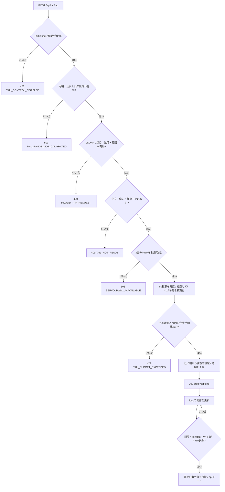

# ESP32 Follower HTTP API仕様

更新日：2026-10-25。実装基準：`9036cce`。 [入口](../esp32/README.md) / [システム仕様](../requirements/esp32.md) / [MCP](../esp32/mcp-integration.md)

対象は[Followerスケッチ](../../firmware/esp32/ESP32-Follower/ESP32-Follower.ino)がHTTPポート80で提供する8つのAPI。PC内の`/api/v1/tail/frequency`は[別の設定API](tail-frequency.md)であり、ここへは送らない。

## 1. 接続・入力・応答

- 起点URLの例は`http://192.168.100.111`、mDNS名は`http://esp32-servo.local`。IPは過去の確認値なので、シリアルの`Servo ESP32 IP:`で現在値を確認する。
- 呼び出す端末からFollowerへ到達できるLANに接続する。認証トークンとAuthorizationヘッダーは不要。
- `/api/tail/tap`の本文はJSON。従来の角度・往復・モード・テレオペのPOSTはフォーム形式。
- 成功はHTTP 200 / `application/json; charset=utf-8`。`/api/tail/*`のエラーはJSON、従来APIと404はテキスト。
- 角度は先端の論理指令0～180。0は丸い側、90は中立、180は伸びる側。応答は実測位置を示さない。
- CORSヘッダーは設定していない。別オリジンのWebページから直接fetchする構成はブラウザの制約を受ける。

## 2. エンドポイント一覧

| メソッド | パス | 本文 | 作用 |
| --- | --- | --- | --- |
| GET | `/api/status` | なし | モード、指令角、PWM、校正値、往復状態 |
| POST | `/api/teleop` | フォーム`angle` | Reader用。テレオペ中だけ受付 |
| POST | `/api/angle` | フォーム`angle` | 指定角へ移動し、`api`で保持 |
| POST | `/api/konkon` | フォーム`start_angle`, `end_angle`, `speed` | 2角度を無期限往復 |
| POST | `/api/mode` | フォーム`mode` | `teleop` / `neutral` / `relax`へ変更 |
| GET | `/api/tail/status` | なし | 有限タップの指令状態・許可設定 |
| POST | `/api/tail/tap` | JSON`duration_ms`, `rate_hz` | 設定された両端を期限付きで動作 |
| POST | `/api/tail/stop` | 空でよい | 現在位置を保持して往復とReader追従を停止 |

## 3. フォームAPI

整数引数は1～3文字の数字だけを受け付ける。空、符号、負数、小数、範囲外を拒否する。以下の入力範囲はソフトウェア上の範囲で、確認済みの機械速度・可動角を保証しない。

| API | 入力と動作 |
| --- | --- |
| `/api/teleop` | `angle=0..180`。`api`、`konkon`、`neutral`、`relax`では409 |
| `/api/angle` | `angle=0..180`。中立・脱力以外で受付。実行中の往復/タップを上書きして停止し、指定角を保持。速度引数なし |
| `/api/konkon` | `start_angle=0..180`、`end_angle=0..180`（異なる値）、`speed=1..180`（先端の指令角度/秒）。中立・脱力では409。それ以外は実行中の往復/タップを置き換えられる |
| `/api/mode` | `mode=neutral`で1500 µsへ移動、`mode=relax`でPWM停止、`mode=teleop`でReaderを再受付。脱力からteleopへ戻る際は先に1500 µsを出す |

`/api/konkon`には時間制限・60秒当たりの予算制限がない。有限タップの代わりに使わない。停止は`/api/tail/stop`、`/api/angle`、モード変更で行える。

## 4. 有限タップ `POST /api/tail/tap`

```http
POST /api/tail/tap
Content-Type: application/json

{"duration_ms":5000,"rate_hz":0.3}
```

| 項目 | 条件 |
| --- | --- |
| JSON本文 | オブジェクトの2フィールドだけ。最大256 bytes |
| `duration_ms` | 数値かつ整数値、500～5000 ms |
| `rate_hz` | 有限な数値、プロトコル範囲0.3～1.0かつ`TAIL_TESTED_MAX_RATE_HZ`以下 |
| 追加識別子 | `command_id` / `session_id` / `stop_generation`は未対応。追加すると拒否 |
| 両端 | `TailConfig.h`の開始・終了角。開始<終了、0～180 |
| 速度 | 設定幅×rate_hzを四捨五入した整数の指令角度/秒 |
| 終了 | 期限をloopで検出して最後の角度を保持。中立復帰・脱力・Reader復帰はしない |

配布exampleは開始許可false、両端90～90。記録上の実機設定は有効・0～180・上限0.3。上限0.3の実機へ0.6を送ると400になる。

`rate_hz`は片側の端への到達を1回として速度へ換算する。幅180・0.3なら54指令角度/秒、片道約3.33秒、1往復約6.67秒が計算上の目安。開始位置・処理遅延・終了期限で実際の動作量は変わる。



予算は最初の受理から60秒の窓で要求時間を予約する。停止・上書きしても払い戻さない。再起動で予算はリセットされる。期限・制御周期はソフトウェアで確認し、通信処理等の遅れがある。

## 5. 停止 `POST /api/tail/stop`

本文なしでよい。タップ許可が無効でも利用可能。現在のタップと通常konkonを止め、最後のPWMを保持する。teleop中は`api`へ切り替え、Readerの上書きも止める。中立・脱力中はそのモードを維持する。

この操作はサーボ電源を切らず、90°へも戻さない。戻すには`mode=neutral`、PWM停止は`mode=relax`、Reader復帰は`mode=teleop`を使う。

## 6. 状態のJSON

### `GET /api/status`

以下は記録上の校正値を使った中立の例で、現在の実機を照会した結果ではない。

```json
{
  "angle": 90,
  "mode": "neutral",
  "pwm_enabled": true,
  "pulse_us": 1500,
  "joint_angle_deg": 90.0,
  "curl_extra_us": 100,
  "pulse_min_us": 600,
  "pulse_max_us": 2400,
  "neutral_pulse_us": 1500,
  "joint_count": 3,
  "konkon_start_angle": null,
  "konkon_end_angle": null,
  "konkon_speed_dps": null,
  "konkon_target": null,
  "tail_tap_active": false,
  "tail_remaining_ms": null,
  "servo_pins": [18, 19, 21]
}
```

`angle`は最後の先端指令、`joint_angle_deg`はパルスと校正幅から求めた名目角。`pwm_enabled`はソフトウェアのモード表示で、実機の電流・回転・接触の確認ではない。脱力中は`pulse_us`と`joint_angle_deg`がnullで、`angle`は最後の値を保持する。

`konkon_*`は往復中の2角度、速度、現在の目標。それ以外ではnull。有限タップ中も`mode=konkon`で、`tail_tap_active=true`と`tail_remaining_ms`が付く。

### `GET /api/tail/status` とtail系POSTの成功応答

```json
{
  "ok": true,
  "state": "idle",
  "enabled": true,
  "feedback": "command_only",
  "angle": 90,
  "remaining_ms": null,
  "rate_hz": null,
  "max_rate_hz": 0.3,
  "start_angle": 0,
  "end_angle": 180
}
```

`state`は有限タップなら`tapping`、通常konkonなら`moving`、それ以外は`idle`。`idle`でも中立・脱力・Reader追従のどれかは分からない。`GET /api/status`のmodeも見る。`enabled=true`だけで開始できる保証はなく、未校正・予算・実行中の判定が別にある。

`remaining_ms`と`rate_hz`はタップ中だけ数値。`feedback=command_only`は指令状態のみで物理確認なし。

## 7. 操作例

動く要求は操作者がリンクを見られる状態で実行する。中立・脱力中は最初にモードを確認する。`mode=teleop`はReaderの現在のつまみ位置へ追従を再開する。

### PowerShell

```powershell
$base = 'http://192.168.100.111'
Invoke-RestMethod "$base/api/status"
Invoke-RestMethod -Method Post "$base/api/mode" -Body @{mode='teleop'}
Invoke-RestMethod -Method Post "$base/api/tail/tap" -ContentType 'application/json' -Body '{"duration_ms":5000,"rate_hz":0.3}'
Invoke-RestMethod -Method Post "$base/api/tail/stop"
Invoke-RestMethod -Method Post "$base/api/mode" -Body @{mode='neutral'}
```

### Linux / macOSのcurl

```sh
base=http://192.168.100.111
curl "$base/api/status"
curl -X POST -d 'mode=teleop' "$base/api/mode"
curl -X POST -H 'Content-Type: application/json' -d '{"duration_ms":5000,"rate_hz":0.3}' "$base/api/tail/tap"
curl -X POST "$base/api/tail/stop"
curl -X POST -d 'mode=neutral' "$base/api/mode"
```

Windowsでcurlを使う場合は`curl.exe`と記載し、JSONの引用符の扱いを利用するシェルに合わせる。Postmanではtail/tapをraw JSON、従来POSTをx-www-form-urlencodedとして送る。

通常の角度・無期限往復の例：`/api/angle`にフォーム`angle=90`、`/api/konkon`にフォーム`start_angle=0&end_angle=180&speed=60`。後者は期限なしで動くため、終了操作まで実行する。

## 8. HTTPエラーと優先順

| HTTP / tailの`error.code` | 条件 |
| --- | --- |
| 400 / `INVALID_TAP_REQUEST` | タップ本文、値、速度上限が不正 |
| 403 / `TAIL_CONTROL_DISABLED` | TailConfigでタップ開始が無効 |
| 409 / `TAIL_NOT_READY` | 中立・脱力・何らかの往復中 |
| 429 / `TAIL_BUDGET_EXCEEDED` | 要求時間合計が窓内10秒を超過 |
| 503 / `TAIL_RANGE_NOT_CALIBRATED` | 両端または上限設定が不正 |
| 503 / `SERVO_PWM_UNAVAILABLE` | タップ開始時にPWM初期化状態が利用不可 |
| 400（従来API・テキスト） | 角度・速度・モード等が不正 |
| 409（従来API・テキスト） | モードによる拒否 |
| 503（従来API・テキスト） | PWM出力に失敗 |
| 404（テキスト） | 未登録のパス/メソッド |

tailのエラー形式は`{"ok":false,"error":{"code":"TAIL_NOT_READY"}}`。tapでは無効設定→校正設定→本文→モード→PWM→予算の順に判定するため、複数条件に該当すれば先のエラーになる。新しい機器コードに401を返す認証処理はない。
