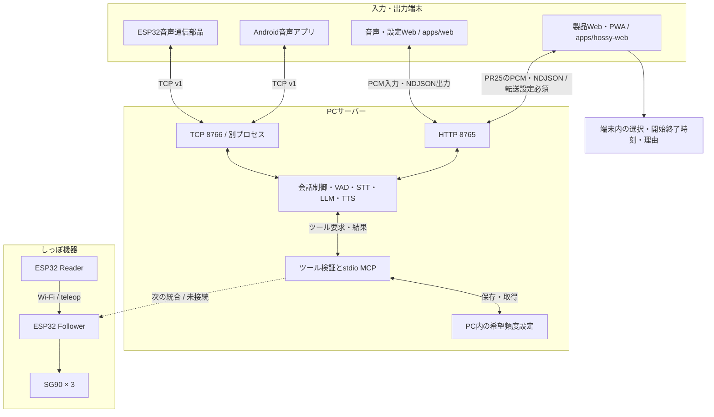
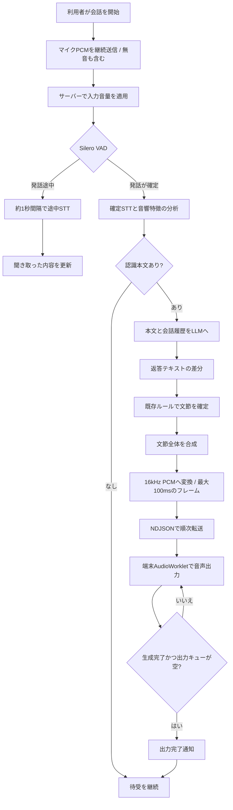
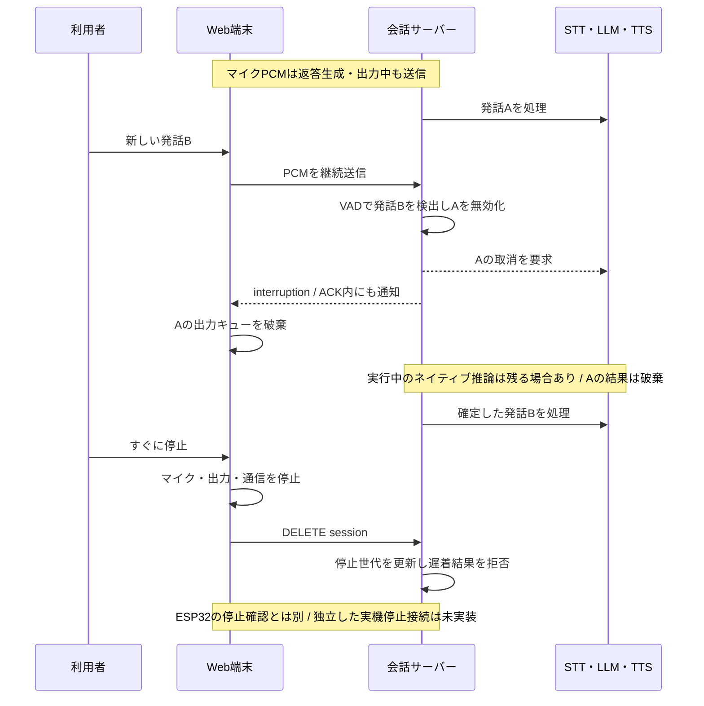
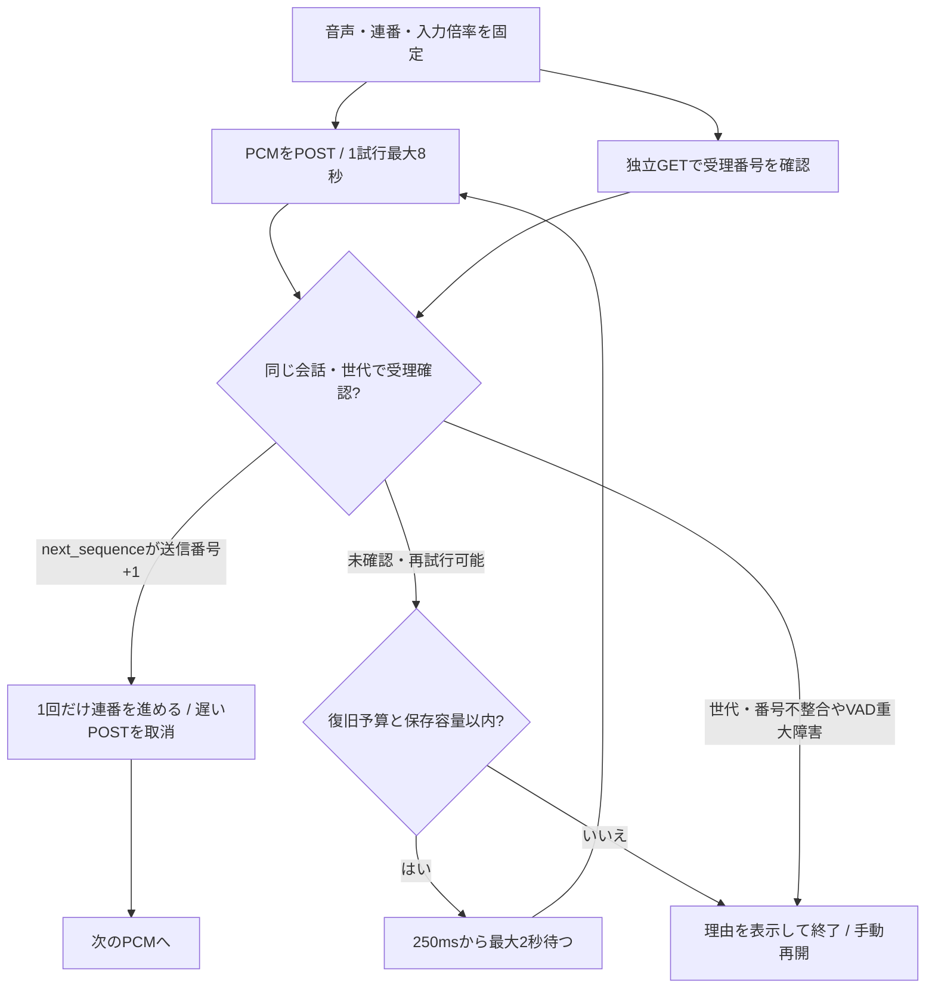
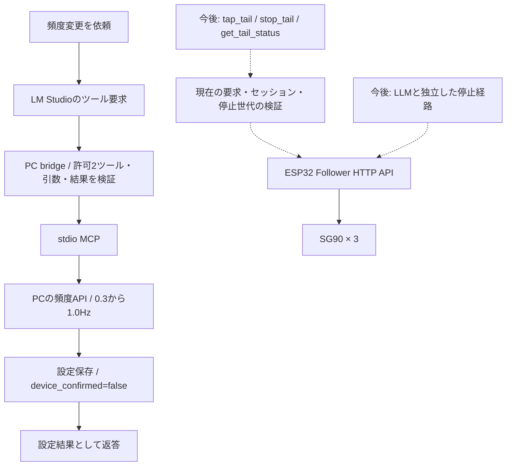
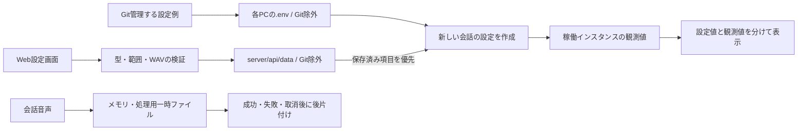
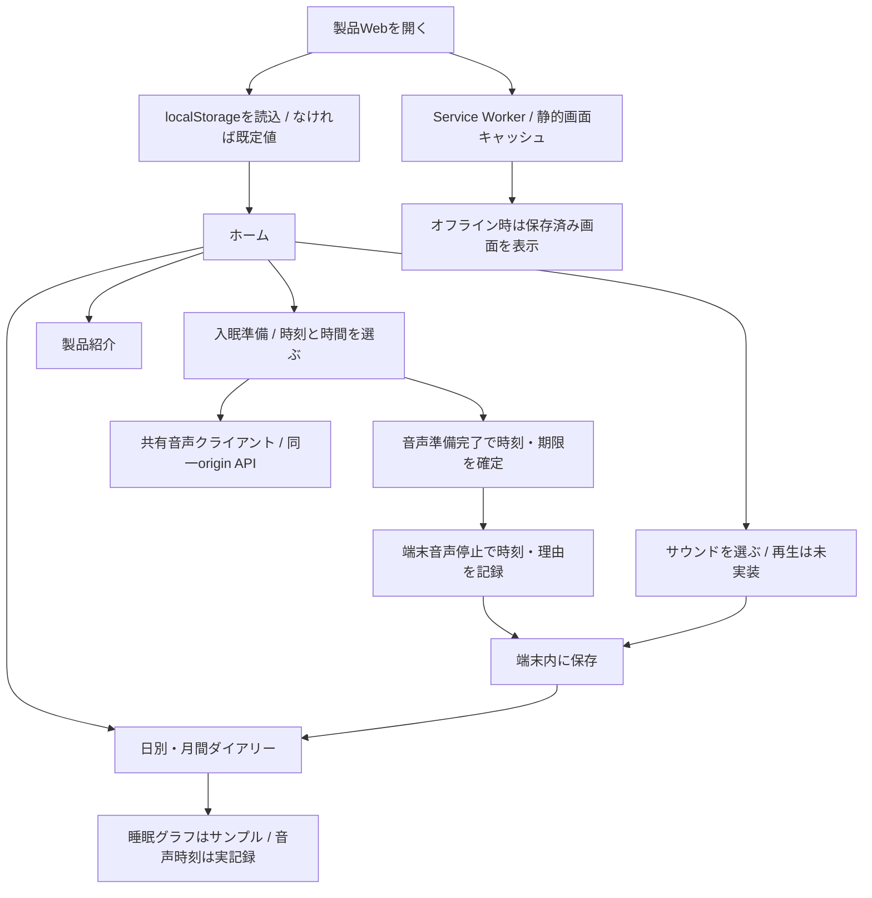

# 現在の構成と処理フロー

> **仕様の対象（2026-10-25）**: 製品Webの最新実装は [PR #25](https://github.com/jphacks/kz_2614/pull/25) / `feature/web-product-mvp` の [`e39aebb`](https://github.com/jphacks/kz_2614/commit/e39aebbe1e71281c88d2c42580a088b01c1b46b6) を参照しています。今回mainへ反映するのは仕様書だけで、PRの実装コードは取り込みません。更新基点のmain `aae38fb` の製品Webは音声API未接続のタイマー版です。「実装済み」は参照先ブランチの状態を含み、mainへのコード統合・公開サイト配備・実機受け入れとは区別します。

[統合仕様書](requirements/system.md) / [ESP32機器仕様](requirements/esp32.md) / [機器HTTP API](api/esp32-http.md)。EMORIの6図は機器仕様・MCP統合・API側に保持しています。

2026-10-25追記: 仕様整理の内容を保ち、公開用のapps/server/firmware/docs配置へリンク・参照先を移行しました。担当と配置は [分担表](development/ownership.md) を参照してください。

更新日: 2026-10-25。main aae38fbのPC/機器仕様と、最新HOSSy UI 2fc13cf・Web MVP e39aebbを照合しています。製品Webは最新UIを保持し、共有音声クライアントから同一originのAPIへ接続するMVPを実装しています。実音声・公開経路は未検証です。

[仕様書一覧](README.md) / [サーバー要件](requirements/server.md) / [端末要件](requirements/clients.md)

図の **実線は実装済みの接続**、**破線は未接続・今後の実装** です。実装済みでも実機確認が済んでいるとは限りません。各図の下の確認状況を併せて読んでください。GitHubのMarkdown表示でMermaidが図として描画されます。

## 1. 全体構成

- **Web経路**: PC上の実モデルHTTP往復を確認した記録があります。新方式のHyperX実マイク・物理出力の聴感確認は残ります。
- **TCP経路**: サーバーの模擬モデル・実ソケット試験あり。最新Android APK、ESP32音声部品のビルド・実機通話は未確認。WebとTCPは別プロセスなので、セッションやモデルインスタンスを共有しません。
- **しっぽ**: Reader/FollowerのソースとEMORI側の実機記録を統合済み。このPCの会話から実サーボを動かす接続は未実装です。

## 2. Web音声の1往復

入力は返答生成・出力中も継続します。上の図は返答の処理順であり、マイクが各処理の完了を待つ意味ではありません。通信は入力PCM、状態取得、出力イベント、再生結果通知を並行して扱います。

**TTSの内部計算途中の音声を取り出す方式ではありません。** 文節の合成が完了すると最大100msに分けて転送し、返答全文の合成完了を待たず端末へ出力します。追加の文節細分化はしていません。

相づちはサーバーが判断します。現在の候補は「うんうん」「ふーん」「へー」。参照音声・設定が一致する保存素材を優先し、なければ生成してメモリへ準備します。待ち時間を超え、最初の本返答がまだなければ最大1回だけ配信します。

## 3. 話しかけ直しと手動停止

話しかけ直しは返答だけを中断し、セッション・入力連番を維持します。手動停止は会話を終了します。「おやすみ」後に短い返事を出して自動終了する制御は受け入れ未完了で、現行は応答指示と相づち抑止までです。

## 4. 音声送信の確認・再送

同一PCMの復旧予算は24,750ms、送信中を含む入力保持は960,000 bytes（約30秒）。Webの1回分は8192 bytes（256ms）。短い遅延では受理番号を確認しながら入力を継続します。長い切断を無制限に保存する仕様ではありません。出力再接続の期限は別で、厳密な総24.75秒を保証しません。詳細は [HTTP API](api/voice-http.md)。

## 5. MCPとESP32の境界

現在の会話に公開するのは `set_tail_frequency` と `get_tail_frequency`。`TAIL_CONTROL_ENABLED=false` で起動するアプリ所有MCPを使います。LM Studioのnative MCP登録をそのまま使う構成ではありません。

ESP32引き継ぎの実動作は **0.3回/秒固定、0.5〜5秒、60秒枠で受理した動作時間の合計10秒まで**。PC保存値0.3〜1.0Hzをそのまま機器へ送ってはいけません。実装時は現要求の許可確認、独立停止、遅着開始の拒否が必要です。開始要求の自動再送、中立解除、Reader追従への自動復帰は行わない設計とします。機器の `feedback: command_only` は物理位置の実測ではありません。

[現行頻度API](api/tail-frequency.md) / [ESP32引き継ぎ](esp32/README.md) / [PC統合の課題](esp32/integration-review.md)

## 6. 設定と保存データ

入力音量はPCMごとの倍率として会話中にも変更できます。VAD・モデル等の保存設定は新しい会話から反映し、進行中の会話を勝手に再起動しません。参照WAVと明示生成した相づちは意図して保持する例外であり、通常の会話録音とは分けます。

## 接続先・実装ファイル

| 経路 | 既定・場所 | 確認範囲 |
| --- | --- | --- |
| 製品Web/PWA | Astro開発127.0.0.1:4321 / `apps/hossy-web` | 音声API接続コードあり。実音声・公開経路・実機未検証 |
| 音声・設定Web | HTTP 127.0.0.1:8765 / `server/api/server.py` | PC実モデルHTTPの記録あり |
| LLM | HTTP 127.0.0.1:1234 / `llm/lm_studio.py` | 指定Gemmaの記録あり。API選択はMCP有効/無効で異なる |
| TTS | `tts/irodori.py`・`tts/local_backend.py` | このPCはlocal Irodori v4.1。テンプレートはGradioの旧既定も保持 |
| Android音声 | TCP 8766 / `voice/tcp_server.py` | サーバー試験あり。最新APK・実機未確認 |
| ESP32音声 | `firmware/esp32/voice_tcp` | 通信部品のみ。機器IO・新PCM出力profile対応は別作業 |
| ESP32しっぽ | Follower HTTP 80 / `/api/tail/*` | EMORI実機記録あり。PC会話からの接続は未完了 |

このPCの確認済みモデルはWhisper small、`google/gemma-4-26b-a4b-qat`、`Aratako/Irodori-TTS-v4.1-Small`。これは過去の実行記録で、今の稼働保証ではありません。最新の観測はWeb稼働表示、設定・実測の履歴は [docs/setup/local-pc.md](setup/local-pc.md) を参照します。

## フォルダー移行

| 以前 | 現在 |
| --- | --- |
| `firmware/esp32Voice` | `firmware/esp32/voice_tcp` |
| `firmware/esp32/codex-memo` | `docs/esp32/history` |
| `Programs/ClientSide/Raspi4Ver` | `docs/archive/raspberry-pi` |

[配置一覧](repository-layout.md)。Pythonはserver、Androidはapps/androidへ移行済みです。ルートの起動スクリプト名は維持しています。旧フォルダーのモデル・venvを参照するPCでは、移行確認前に旧チェックアウトを削除しないでください。

## ソース配置と分担

製品Webはapps/hossy-web、音声・設定Webはapps/web（HOSSy）、AI・APIはserver（kameyama）、ESP32はfirmware/esp32（EMORI）、Androidはapps/android。詳しい配置は [フォルダー構成](repository-layout.md)、共同作業は [担当範囲](development/ownership.md) を参照してください。

ルートの起動スクリプト名は維持し、Pythonのモジュールと設定保存場所を新配置へ変更しました。[ローカル環境の移行](development/layout-migration.md) が必要です。モデルを保持する旧kz_2614フォルダーは削除しません。

## 7. 製品Webの画面・保存フロー

製品Webの保存先は配信originごとのlocalStorageです。音声管理Webの設定保存先server/api/dataとは別です。SWは静的許可リストのみを保存し、API・認証・音声を除外します。[画面仕様](requirements/web-product.md) / [PR #25の起動とPWA](https://github.com/jphacks/kz_2614/blob/e39aebbe1e71281c88d2c42580a088b01c1b46b6/docs/setup/hossy-web.md)。
