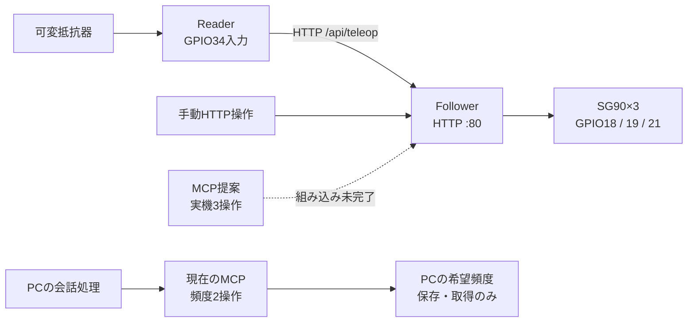

# ESP32しっぽ制御・現行仕様

更新日：2026-10-25。統合後の実装 `9036cce` を読み、機器の実装、現在のPC側MCP、未接続の提案を整理した。実機の現在IP・姿勢を再確認した文書ではない。

## 最初に読む文書

| 目的 | 文書 |
| --- | --- |
| Arduino IDEで準備する | [機器側README](../../firmware/esp32/README.md) |
| 配線・角度変換・校正・モードを理解する | [システム仕様](specification.md) |
| ESP32へHTTPを送る | [HTTP API仕様と操作例](http-api.md) |
| PCのMCPと実機を接続する担当者 | [MCPの現状と統合仕様](mcp-integration.md) |
| ESP32音声通信を扱う | [VoiceTCP](../../firmware/esp32/voice_tcp/README.md) |
| 過去の測定・判断を確認する | [日時付きの実機記録](history/2026-10-25-0222-LLMしっぽMCP統合調査.md) |

現行仕様の参照先はこのフォルダの3仕様書とする。`history/`は当時の実験・引き継ぎ記録で、古いIP、COM番号、認証の有無、配置、MCPの公開ツールを現行設定として使わない。

## 構成と接続状況

| 区分 | 現在の状態 |
| --- | --- |
| Reader → Follower → SG90 3台 | Arduino実装あり。手元の実機試験記録あり |
| FollowerのHTTP API | 8エンドポイントを実装。トークン不要 |
| 現在の会話用MCP | `set_tail_frequency` / `get_tail_frequency`。PCの設定だけを変更・取得 |
| 実機用MCP提案 | `tap_tail` / `stop_tail` / `get_tail_status`。`history/`に保管、会話へ未接続 |
| VoiceTCP | ESP-IDF向け通信部品。Reader/Followerと独立。マイク・スピーカー・GPIOの実装なし |

PCの希望頻度APIは0.3～1.0 Hzを保存できるが、記録上の実機のタップ上限は0.3回/秒。保存した頻度が自動で機器に適用される処理はない。

## 起動と停止の要点

- Followerは起動時に3台へ1500 µsを出し、その後は`teleop`としてReader指令を受け付ける。
- `mode=neutral`は90°へ移動して保持、`mode=relax`はPWM停止、`/api/tail/stop`は最後の指令位置で保持する。
- 中立・脱力中の角度指令やタップ開始は拒否する。自動解除はしない。
- タップ終了後もReaderへ自動復帰しない。復帰は`mode=teleop`で明示する。
- IP `192.168.100.111`は記録上の例。現在値はFollowerのシリアル出力で確認する。

## 検証を読むときの区別

機器側のビルド・書き込み、GPIOのパルス幅、操作者による動作観察、提案Pythonの22テストは[履歴](history/2026-10-25-0222-LLMしっぽMCP統合調査.md)に根拠を残している。統合後の会話サーバーから実機を操作した受け入れ試験の完了を示すものではない。

仕様書整理ではコードを変更せず、実機への要求・サービス再起動・マイク操作は行わない。今回の文書検証はMarkdownリンク、Mermaidの描画、差分確認として作業履歴へ記録する。
