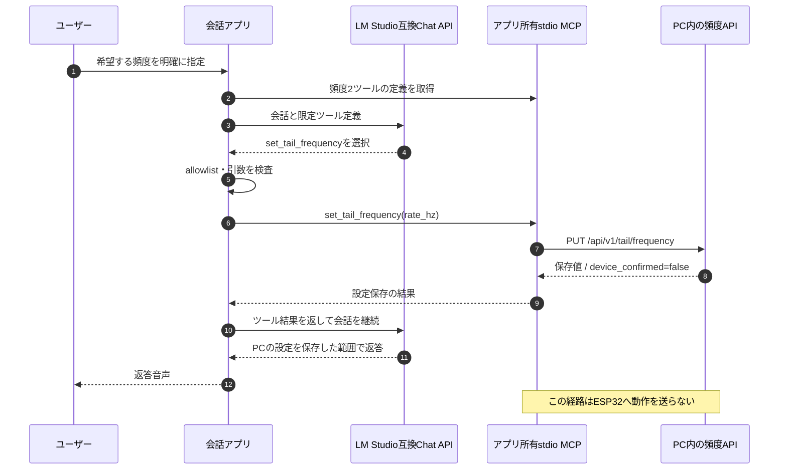
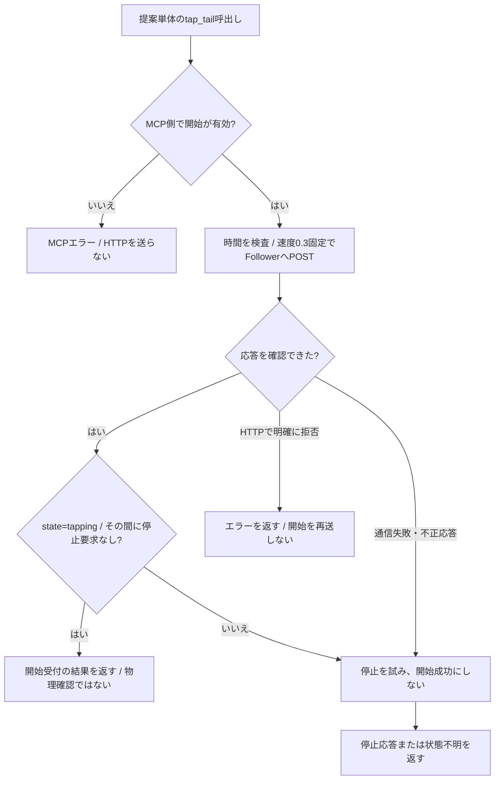

# MCPの現状とESP32統合仕様

**今回の対象・修理順・合格条件は [MVP.md](../../MVP.md) を優先します。** 現状の頻度2操作と、これから実装する有限tap・独立停止・機器側停止フェンスを区別します。PC/MCPの世代検査とstop再送だけでは遅着tapを防げません。PC/ESP32双方で [未実装v2契約](../api/mvp-tail-control-v2.md) に揃え、version/capability・epoch/世代・冪等command・停止後/再起動/次sessionの旧開始拒否を確認してから、mock→実機→Webの順に検証します。契約変更はmainの仕様PRを先に出します。旧APIに未対応キーを送らず、未対応機器の実機開始は無効です。以下の提案単体はこの新契約の実装済み説明ではありません。

更新日：2026-10-25。実装基準：`9036cce`。 [入口](README.md) / [機器仕様](../requirements/esp32.md) / [Follower HTTP API](../api/esp32-http.md)

## 1. 現在のサーバーと提案を区別する

| 項目 | 現在の会話サーバー | ESP32担当の提案Python |
| --- | --- | --- |
| ファイル | [server/ai/tail_mcp_server.py](../../server/ai/tail_mcp_server.py) | [history/2026-10-25_0313_tail_mcp_server.py](history/2026-10-25_0313_tail_mcp_server.py) |
| 会話へ公開 | `set_tail_frequency(rate_hz)` / `get_tail_frequency()` | 単体では`tap_tail(duration_seconds)` / `stop_tail()` / `get_tail_status()` |
| 接続先 | PC内の頻度設定API | ESP32 Follower HTTP API |
| 動作 | 希望値の保存・取得だけ | 指令の開始・停止・機器状態照会 |
| 会話との接続 | アプリ所有stdioブリッジを実装 | 現在のブリッジへは未統合 |
| 実機確認の意味 | `device_confirmed=false` | `feedback=command_only`で機械位置は未測定 |

現行MCP本体には互換用の旧`tap_tail`等3関数も残るが、会話ブリッジが公開・受付するのは頻度2操作だけ。[tail_tools.py](../../server/ai/llm/tail_tools.py)のallowlist、引数検査、結果検査を通る必要がある。

互換用`tap_tail`の既定値は2秒・0.6回/秒で、提案の5秒・0.3固定とは異なる。記録上の実機上限0.3へ既定値を送ると400になる。互換用の状態取得にも提案の`ready_to_tap`合成はない。以下の提案仕様を、稼働側の互換関数の実装済み機能として扱わない。

## 2. 現在の会話経路

設定APIの起点は`TAIL_DASHBOARD_URL`、既定は`http://127.0.0.1:8765`。`GET`/`PUT /api/v1/tail/frequency`が0.3～1.0 Hz（未設定0.6）を扱い、`applies_to=configuration`、`device_confirmed=false`を返す。詳細は[PC頻度API](../api/tail-frequency.md)を正本とする。

`TAIL_MCP_ENABLED=true`で会話アプリのMCP経路を利用する。ブリッジは子MCPへ`TAIL_CONTROL_ENABLED=false`を明示するので、.envをtrueへ変えるだけで実機操作が有効になる構成ではない。この経路にLM Studio nativeの`mcp.json`登録は不要。

## 3. 提案Python単体の実機操作

これは現在の会話へ接続済みの説明ではなく、保存してある提案のHTTP契約を示す。

| ツール | 条件・HTTP |
| --- | --- |
| `tap_tail(duration_seconds=5.0)` | 0.5～5.0秒。JSONの`duration_ms`へ変換し、`rate_hz=0.3`固定でPOST `/api/tail/tap` |
| `stop_tail()` | POST `/api/tail/stop`の後、GET `/api/tail/status`。停止応答と再照会を区別 |
| `get_tail_status()` | GET `/api/tail/status`とGET `/api/status`から指令状態・mode・`ready_to_tap`を合成 |

タップは最大5秒、通信は接続1秒指定・要求全体3秒。開始が不明な失敗では停止を試みるが、通信断なら結果不明を返す。開始は自動再送しない。停止と重なった処理中の開始はMCP内の世代番号で検出し、停止を再送する。

`ready_to_tap`は、MCPと機器の有効設定、idle、許可モード、PWMモード、設定された両端、0.3を扱える上限から算出する。残り時間予算は公開されず、trueでも次の開始が429となる場合がある。

## 4. 設定の役割

| 設定 | 現在のサーバーでの用途 | 提案での用途 |
| --- | --- | --- |
| `TAIL_MCP_ENABLED` | 会話ブリッジ利用。既定false | 提案本体は読まない。呼び出し元側の設定 |
| `TAIL_DASHBOARD_URL` | 頻度設定用loopback URL | 読まない |
| `TAIL_CONTROL_ENABLED` | 互換開始関数のゲート。会話ブリッジは子でfalseを強制 | 実機タップ開始のゲート。既定false |
| `TAIL_DEVICE_URL` | 互換機器関数向け。頻度2操作は使用しない | FollowerのURL。例`http://192.168.100.111` |
| `TAIL_MCP_PLUGIN_ID` | 現在のアプリ所有ブリッジは使わない | 過去のnative登録向けの説明。提案本体は読まない |
| `TAIL_DEVICE_TOKEN` | 不要 | 不要 |

`load_dotenv(..., override=False)`なのでプロセス環境が優先する。提案ファイルをhistoryから直接起動すると.envの相対位置も稼働配置と異なる。履歴の「2つのフラグをtrueにしてnative登録」の手順は旧呼び出し元を前提としており、現在の会話へそのまま適用しない。

## 5. 統合時に実装・確認すること

1. 現在の[受け取り側レビュー](integration-review.md)を読み、実機3操作をどこから呼び出すか決める。MCP本体の丸ごと置換だけでは頻度2操作用の検出・検証が失敗する。
2. 会話側allowlist・引数・結果検証・起動環境を3操作の契約へ合わせる。ユーザーの明確な要求を検査する。ツールの追加は最小限にする。
3. PC希望頻度0.3～1.0と実機上限0.3を混同しない。保存値を黙って実機へ送らない。今回の実機用提案は速度引数を公開しない。
4. 中立・脱力を自動解除しない。現在のIPとモードを読み、操作者がReaderのつまみ位置を確認して準備する。
5. 会話停止・取消から、LLMを待たない独立した機器停止と状態再照会を接続する。
6. 停止済みセッションからの古い開始を発行しないよう、会話・LM Studio・MCPの境界で取消と世代を検査する。機器APIへ未対応の識別子を追加しない。
7. 模擬HTTP・stdio・会話経路を試験後、操作者立会いで動作・期限・途中停止を確認する。保存成功やHTTP 200を物理動作の確認としない。

現行の機器APIにセッションIDや停止世代はない。提案内の世代だけでは、まだMCPへ届いていない古い会話要求を見分けられない。完全な遅着拒否が実装済みという扱いにしない。

## 6. 検証状況

提案Pythonは送信側環境で22テストと実stdio→模擬HTTPの確認済み。統合前の機器ではHTTP・パルス・操作者の観察記録がある。統合後の実サーバーから機器までの受け入れは未完了。

現在のサーバーの頻度2操作には既存テストがあるが、これは3操作の実機連携完了の根拠ではない。この仕様書整理でサービスやマイクを再起動せず、機器へのリクエストも送らない。
