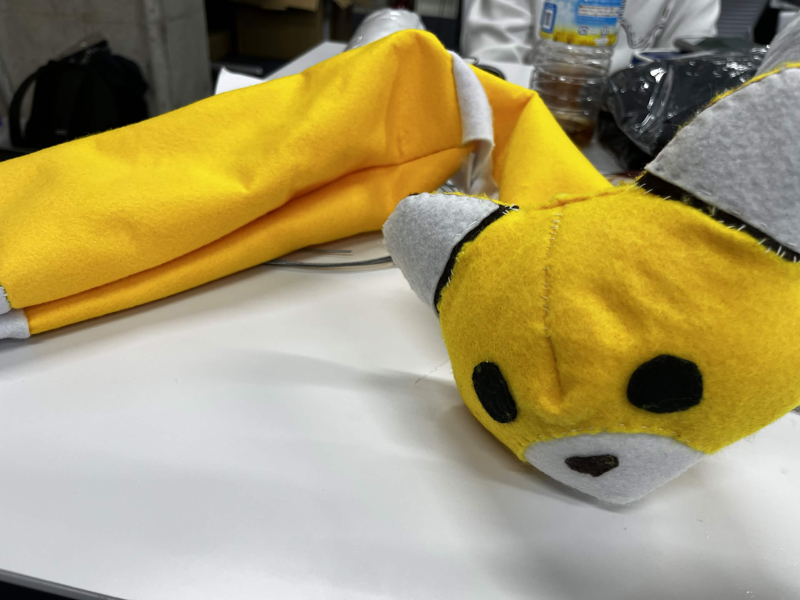
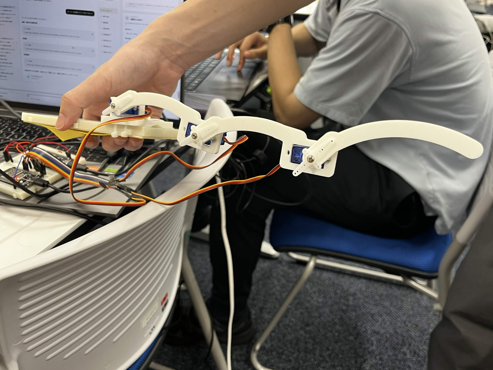
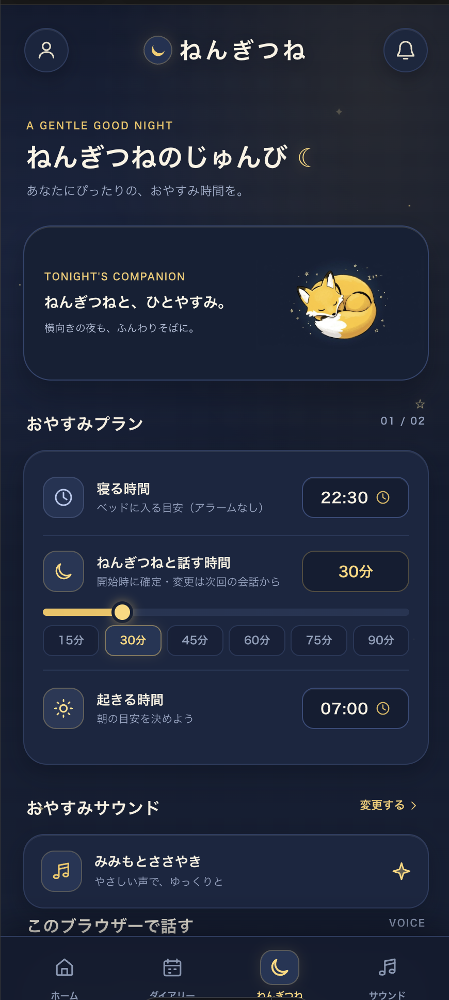

# ねんぎつね 制作ギャラリー

[製品紹介へ戻る](../README.md) / [デモ手順](demo.md)

2026年10月25日に提供された写真・画面です。外装、内部機構、製品Webを紹介します。写真は制作状況の記録であり、全機能の動作試験結果を示すものではありません。

## きつね型の外装

耳・顔・胴体の形をつくった試作品。内部機構と組み合わせる前の制作状態です。

## しっぽの内部機構

サーボ、関節部、配線の配置が見える試作品。[収録している3Dプリント部品](../3Dprint/README.md)と、[機器の仕様](requirements/esp32.md)も参照してください。

## おやすみの準備画面

  

会話時間は30分を選択した状態です。寝る時間・起きる時間は目安の設定です。画面上の項目だけでバックエンド連携やアラーム実装済みとは判断せず、[製品Web仕様](requirements/web-product.md)で現在の対応範囲を確認してください。

## デモ動画

準備中です。掲載時は、使用した版と「会話開始 → AIの再生としっぽの動作 → 停止 → 利用記録」が分かる動画を追加します。現時点の再現手順と検証状況は [デモ手順](demo.md) に記載しています。

## 掲載素材

| ファイル | 提供された素材 | 用途 |
| --- | --- | --- |
| `fox-prototype.jpg` | `IMG_7985.jpg` | 外装試作 |
| `tail-prototype.jpg` | `IMG_7983.jpg` | 内部機構 |
| `web-routine.png` | 2026-10-25 14:48:12のスクリーンショット | 製品Webの準備画面 |

元画像の内容は加工せず、README用の名前でコピーしています。表示サイズのみMarkdown/HTML側で指定しています。
