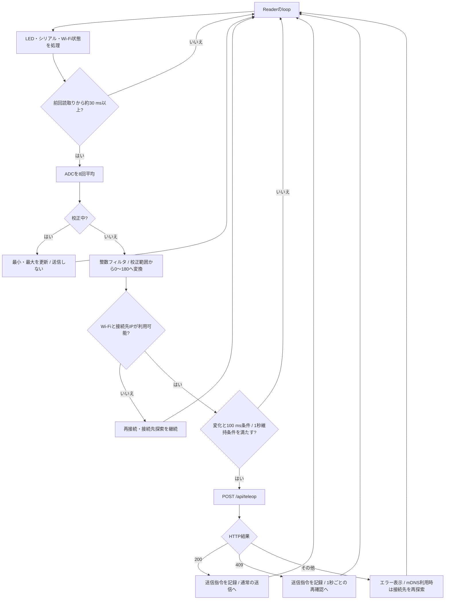
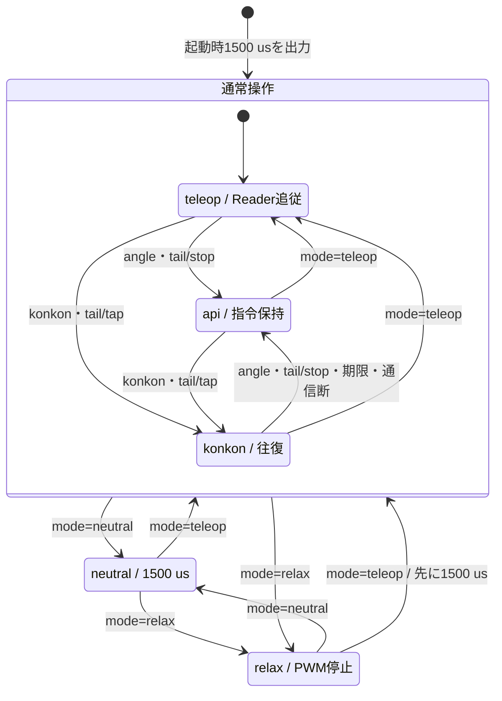

# ESP32しっぽ制御 システム仕様

更新日：2026-10-25。実装基準：`9036cce`。 [入口](../esp32/README.md) / [HTTP API](../api/esp32-http.md) / [MCP](../esp32/mcp-integration.md)

## 1. 役割と対象機器

| 構成要素 | 役割 | 実装 |
| --- | --- | --- |
| Reader | 可変抵抗器の値を先端指令0～180へ変換 | [ESP32-Reader.ino](../../firmware/esp32/ESP32-Reader/ESP32-Reader.ino) |
| Follower | HTTPを受け、SG90 3台へ同じPWMを出す | [ESP32-Follower.ino](../../firmware/esp32/ESP32-Follower/ESP32-Follower.ino) |
| PC側 | 現在は希望頻度の保存・取得。実機への会話連携は未完了 | [MCP仕様](../esp32/mcp-integration.md) |

スケッチは従来のESP32 DevKit / ESP32 Dev Moduleを想定する。ESP32-C3等へそのままピン配置を適用しない。既存のビルド・書き込みはArduino-ESP32 3.3.12で確認された。ソースには2系/3系のLEDC分岐があるが、すべてのボード・版を実機確認した意味ではない。

## 2. 配線・識別・ネットワーク

| 部品 | 接続先・設定 |
| --- | --- |
| 可変抵抗器の両端 | Readerの3V3とGND |
| 可変抵抗器の中央 | Reader GPIO34 / ADC1、12 bit、`ADC_11db` |
| SG90 1/2/3の信号 | Follower GPIO18 / 19 / 21 |
| SG90の電源 | 外部5 V、3台分の電流容量。全サーボとFollowerを共通GND |
| 識別LED | 両方GPIO2、既定はHIGH点灯 |
| シリアル | 115200 bps |
| Wi-Fi | 同じ2.4 GHzネットワーク |
| Follower API | HTTPポート80、`esp32-servo.local`をmDNSで広告 |
| Readerの接続先 | `RECEIVER_IP`を優先。空の場合はmDNSでFollowerを探索 |

ReaderのLEDは約1.8秒ごとに180 ms点灯1回。Followerは同じ周期で0～180 msと360～540 msの2回点灯。基板LEDがGPIO2にない場合は外付けまたは定数変更が必要。COM番号の大小では役割を決めない。

可変抵抗器を5 Vで給電しない。サーボをGPIO/3V3から給電しない。外部電源とUSBの＋を不用意に接続せず、共通化するのはGND。機構変更・配線変更時は電源を切る。

## 3. 設定と保存先

| ファイル/保存先 | 内容 | 配布状態 |
| --- | --- | --- |
| Reader `WiFiConfig.h` | `WIFI_SSID`, `WIFI_PASSWORD`, `RECEIVER_IP` | exampleからコピーして作成 |
| Follower `WiFiConfig.h` | `WIFI_SSID`, `WIFI_PASSWORD` | exampleからコピーして作成 |
| Follower `TailConfig.h` | タップ許可、両端の先端指令、確認済み速度上限 | exampleからコピーして作成 |
| Reader NVS `pot-range/range` | ADC校正の最小・最大 | 機器内に保存 |
| Follower NVS `servo-pwm/range`, `curl` | パルス校正範囲と丸まり補正 | 機器内に保存 |

`WiFiConfig.h`と`TailConfig.h`の実設定はGitに含めない。APIのトークン変数・Authorizationヘッダーは不要。

| 項目 | 新規機器の既定値 | 既存機構の記録値 |
| --- | --- | --- |
| ADCの最小～最大 | 0～4095 | 0～4095 |
| サーボ校正範囲 | 1000～2000 µs | 600～2400 µs |
| 0側の丸まり補正 | 0 µs | 100 µs |
| タップ許可 | exampleはfalse | 実機記録はtrue |
| タップ両端 | exampleは90～90で未設定 | 実機記録は0～180 |
| タップ速度上限 | exampleは0.3回/秒 | 実機記録は0.3回/秒 |

右列は履歴に残る1つの機構の値で、新しい個体に測定なしで適用する校正結果ではない。NVSの値はソースを書き込むだけでは作成されず、通常の再書き込みで既存値が残る場合もあるため`v`で確認する。

## 4. Readerの角度変換と送信

1回の読取りは8回のADC平均。通常は約30 ms間隔で読み、`filtered=(3×前回+今回)/4`の整数フィルタを適用する。校正中はフィルタ前の平均値で最小・最大を記録し、角度送信を止める。

校正範囲を`L..H`、範囲内へ制限したADC値を`R`とすると、先端指令は次の整数計算で求める。

```text
A = ((R - L) × 180 + (H - L) / 2) / (H - L)
```

| 項目 | 値 |
| --- | --- |
| 変化による送信条件 | 前回成功/拒否時の指令から2以上変化し、前回送信から100 ms以上 |
| 維持送信 | 1秒ごと |
| HTTP 409後 | 1秒ごとの維持送信だけで再確認 |
| 接続・読み取りタイムアウト設定 | 各700 ms。要求全体700 msの保証ではない |
| mDNS再探索の間隔 | 接続先不明時に約5秒ごと、照会待ち最大1500 msの指定 |



## 5. 先端指令と3台のPWM

PWMは50 Hz、14 bit、周期20000 µs。全3ピンへ同じパルス幅を出す。先端指令を`A`、校正範囲の幅を`S=maxPulse-minPulse`、丸まり補正を`C`とする。

```text
P = 1500 + ((A - 90) × S) / (180 × 3)
A < 90 の場合だけ P = P - C × (90 - A) / 90
```

実装は整数計算で、小数部を切り捨てる（負数は0方向への切り捨て）。中立は校正幅にかかわらず1500 µs固定。

| 先端指令A | 記録値S=1800, C=100の共通PWM | パルスから計算する各関節の名目角 |
| --- | --- | --- |
| 0 | 1100 µs | 約50° |
| 90 | 1500 µs | 90° |
| 180 | 1800 µs | 120° |

丸まり補正なしなら中央1/3を使い、名目上は各関節60～120°。補正で丸い側を広げるため、実際の先端の向きが厳密に0～180°になるとは限らない。リンク形状・ホーン位置・個体差があり、角度センサーもない。

## 6. Followerのモードと状態遷移

| `mode` | 出力と受付 |
| --- | --- |
| `teleop` | PWM保持し、Readerを受け付ける。起動後の論理モード |
| `api` | 最後のAPI指令を保持。Readerを409で拒否 |
| `konkon` | 往復中。有限タップもこのモードで、`tail_tap_active`で区別 |
| `neutral` | 3台を1500 µsへ動かして保持。角度・往復・タップ開始を拒否 |
| `relax` | 3ピンのPWMデューティ0。サーボの電源は継続。開始指令を拒否 |



図は操作が受理された場合の遷移を示す。「通常操作」は図上で3モードをまとめた枠で、APIに返るmode名ではない。同じモードへの操作も受け付ける。`/api/tail/stop`は`neutral`と`relax`を解除せず、そのまま保つ。シリアル`n/d/t`は対応するモード操作と同じ目的を持つ。

起動時の1500 µsは「中立モードで起動する」という意味ではない。`BOOT_IN_NEUTRAL_MODE=false`なので、HTTPが利用可能になるとReaderのつまみへ追従する。中立/脱力状態はNVSへ保存せず、再起動するとテレオペへ戻る。

## 7. 往復・有限タップ・通信断

| 機能 | 無期限konkon | 有限タップ |
| --- | --- | --- |
| 入口 | `/api/konkon` | `/api/tail/tap` |
| 角度 | 要求の開始・終了角 | `TailConfig.h`の両端 |
| 初めの目標 | 現在が開始角なら終了角、それ以外は開始角 | 近い端。既にその端なら反対側 |
| 速度 | 指令角度1～180/秒 | 設定幅×rate_hzを四捨五入した整数の指令角度/秒 |
| 終了 | 明示操作、Wi-Fi切断、PWM書込み失敗 | 左記＋要求した500～5000 msの期限 |
| 60秒/10秒の受付制限 | 適用しない | 適用する |

`rate_hz`は片側の端への到達を1回として数える。記録の幅180・0.3では54指令角度/秒、端から端まで約3.33秒、1往復約6.67秒が計算上の目安となる。

更新は約20 msごと。長い処理待ち後は1回の計算に使う経過時間を最大50 msに制限し、位置を一気に追いつかせない。通信・シリアル処理等による遅れがあるため、周期と期限はハードリアルタイムの保証値ではない。

有限タップは、最初の受理を起点にした60秒の窓で要求時間を合計し、10秒を超える要求を429で拒否する。停止や途中上書きでも予約済み時間を払い戻さない。60秒経過後の次の受付で窓をリセットする。再起動でもリセットされる。

Follower自身のWi-Fi切断を検出すると往復を止め、最後のPWMを保持する。Readerだけが送信を止めた場合は受信期限によるモード切替はなく、最後の指令を保持する。いずれも自動脱力や電源遮断ではない。

## 8. シリアル校正

Readerのコマンドは大文字・小文字を受け付ける。Followerは表の小文字/数字を使う。改行は処理対象外として無視される。

| 対象 | コマンド | 意味 |
| --- | --- | --- |
| Reader | `c` | 校正開始。送信停止し、両端のADC平均値を記録 |
| Reader | `s` | 幅128以上で校正を適用・保存し、送信再開。保存失敗時もRAMへ適用されたことを表示 |
| Reader | `x` | 中止して以前の範囲で送信再開 |
| Reader | `v` | 生値と現在の範囲を表示 |
| Reader | `r` | 保存範囲を消し、0～4095へ戻す |
| Follower | `1` / `2` | 下限を-50 / +50 µs |
| Follower | `3` / `4` | 上限を+50 / -50 µs |
| Follower | `5` / `6` | 0側の丸まり補正を+50 / -50 µs |
| Follower | `v` | 校正値、丸まり補正、LEDCとGPIOのHIGH時間を表示 |
| Follower | `n` / `d` / `t` | 中立 / PWM停止 / テレオペ再開 |
| Follower | `s` | 校正範囲と丸まり補正を保存 |
| Follower | `r` | 保存値を消し、1000～2000 µs・補正0へ戻す |

Followerの調整可能値は下限500～1000 µs、上限2000～2500 µs、丸まり補正0～150 µs。これはソフトウェアの制限で、個々の機構の許容範囲を保証しない。片側50 µsずつ観察し、確認後に保存する。中立・脱力中の調整では直ちに新しい角度PWMへ更新しない。

## 9. 実装・検証の範囲

[実機記録](../esp32/history/2026-10-25-0222-LLMしっぽMCP統合調査.md)には、GPIOのHIGH時間約1502～1503 µs、中立復帰、有限動作・途中停止、操作者の異音・接触なしの報告がある。GPIOパッドでの読取りはサーボ端子・機械位置の計測ではない。

3台接続時の電源電流、先端角度/速度の厳密な計測、通信断の実物試験、統合後PC会話からの実機受け入れは未確認として扱う。現在のIP・COM・NVS値・モードは実行時に確認する。
